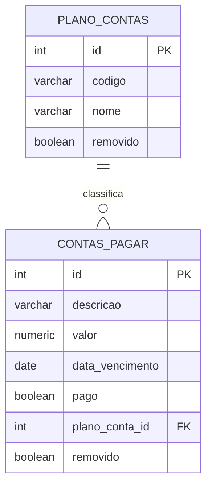

# Financeiro da Cooperativa — Contas a Pagar × Plano de Contas

Trabalho 1 de **Desenvolvimento Web III** (IFSP Votuporanga · Bacharelado em Sistemas de Informação).
Módulo financeiro de um ERP de cooperativas, com CRUD de duas tabelas relacionadas (**1:N**), login e rotas protegidas por **JWT**.

## Stack

| Camada | Tecnologia | Porta |
|---|---|---|
| Front-end | HTML + CSS + JavaScript puro, servido por `python -m http.server` | **8080** |
| Back-end (API REST) | Python + Flask (+ PyJWT, flask-cors, psycopg2) | **5000** |
| Banco de dados (SGBD) | PostgreSQL 16 | **5432** |

Tudo roda em containers Docker (3 serviços, 3 portas separadas — arquitetura cliente-servidor).

## Como rodar

Pré-requisito: Docker com Docker Compose.

```bash
cp .env.example .env        # ajuste as senhas se quiser
docker compose up --build
```

Depois acesse **http://localhost:8080** e entre com o usuário definido no `.env`
(padrão: `admin` / `admin123`).

Para parar: `Ctrl+C` e `docker compose down`.
Para apagar também os dados do banco e recomeçar do zero: `docker compose down -v`.

> O `init.sql` só roda quando o volume do banco está vazio. Se mudar o schema, use `docker compose down -v` antes de subir de novo.

## Estrutura do projeto

```
coop-financeiro/
├── docker-compose.yml        # orquestra db + backend + frontend
├── .env.example              # modelo de variáveis (o .env real fica fora do Git)
├── .gitignore
├── database/
│   └── init.sql              # tabelas + dados de exemplo
├── backend/                  # API Flask (porta 5000)
│   ├── app.py                # cria o app, registra as rotas, CORS
│   ├── db.py                 # conexão e execução de SQL
│   ├── auth.py               # login + decorator @token_obrigatorio (JWT)
│   ├── plano_contas.py       # 5 APIs do CRUD de Plano de Contas
│   ├── contas_pagar.py       # 5 APIs do CRUD de Contas a Pagar
│   ├── requirements.txt
│   └── Dockerfile
├── frontend/                 # interface (porta 8080)
│   ├── index.html            # tela de login
│   ├── app.html              # sistema (abas Contas a Pagar / Plano de Contas)
│   ├── css/style.css
│   ├── js/config.js          # URL da API
│   ├── js/api.js             # as 10 funções do CRUD + login + sessão
│   ├── js/login.js
│   ├── js/app.js             # lógica das telas
│   └── Dockerfile
└── docs/
    ├── ARQUITETURA.md        # diagramas (Mermaid) e decisões
    ├── API.md                # referência das rotas, com exemplos
    └── ROTEIRO_APRESENTACAO.md   # guia para explicar/demonstrar ao professor
```

## Modelo de dados



Mais detalhes (e demais diagramas) em [`docs/ARQUITETURA.md`](docs/ARQUITETURA.md).

## Conferência com o enunciado do PDF

| Exigência | Onde está |
|---|---|
| Cliente-servidor, servidores em portas separadas | Front `8080`, API `5000`, banco `5432` (`docker-compose.yml`) |
| Repositório no GitHub com `.gitignore` | `.gitignore` na raiz (ignora `.env`, `__pycache__` etc.) |
| Dados em um SGBD | PostgreSQL (`database/init.sql`) |
| 2 tabelas relacionadas (1:N) | `plano_contas` 1 ── N `contas_pagar` |
| Campos `ID` e `Removido` em todas as tabelas | colunas `id` e `removido` nas duas |
| Ao menos um campo texto, decimal e data | texto: `descricao`/`nome` · decimal: `valor` (`NUMERIC(12,2)`) · data: `data_vencimento` |
| 5 APIs por tabela (GetAll, GetByID, Insert, Update, Delete) | `backend/plano_contas.py` e `backend/contas_pagar.py` |
| GetAll/GetByID só trazem `removido = false` | cláusula `WHERE removido = FALSE` |
| Delete = *soft delete* | `UPDATE ... SET removido = TRUE` |
| 5 funções de CRUD no front por tabela | `frontend/js/api.js` |
| Tela de login | `frontend/index.html` |
| JWT protegendo as rotas | `@token_obrigatorio` em `backend/auth.py` |
| JWT e dados do login guardados no front | `localStorage` (`salvarSessao` em `api.js`) |
| Front nunca acessa o SGBD | só o back-end importa `psycopg2` |
| Boa usabilidade | busca, filtro, confirmação de exclusão, mensagens de erro, formatação em R$ e `dd/mm/aaaa` |
