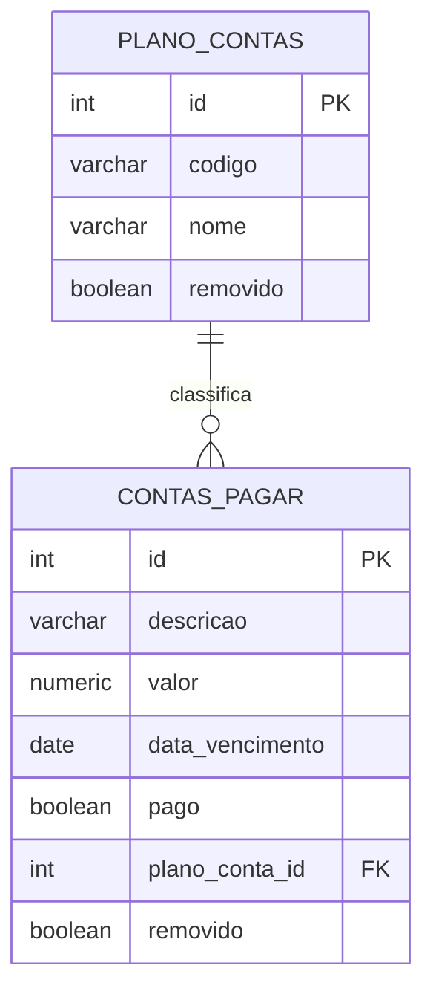

# Financeiro da Cooperativa — Contas a Pagar × Plano de Contas

Trabalho 1 de **Desenvolvimento Web III** (IFSP Votuporanga · Bacharelado em Sistemas de Informação).
Módulo financeiro de um ERP de cooperativas, com CRUD de duas tabelas relacionadas (**1:N**), login e rotas da API protegidas por **JWT**.

## Stack

| Camada | Pasta | Tecnologia | Porta |
|---|---|---|---|
| Front-end (site) | `dw3frontend/` | Python + Flask, templates Jinja, CSS e um pouco de JS | **8080** |
| Back-end (API REST) | `dw3backend/` | Python + Flask, PyJWT, psycopg2 | **5000** |
| Banco de dados (SGBD) | container `db` | PostgreSQL 16 | **5432** |

Tudo roda em containers Docker (3 serviços, 3 portas separadas — arquitetura cliente-servidor).
O front **nunca** acessa o banco: ele chama a API, e só a API fala com o PostgreSQL.

## Como rodar

Pré-requisito: Docker com Docker Compose.

```bash
# 1ª vez (se os arquivos de configuração ainda não existirem):
cp dw3backend/.env.example dw3backend/.env
cp dw3frontend/frontend.env.example dw3frontend/frontend.env

docker compose up --build
```

Acesse **http://localhost:8080** e entre com `admin` / `admin123` (definidos no `dw3backend/.env`).

- Parar: `Ctrl+C` e `docker compose down`
- Apagar também os dados do banco e recomeçar do zero: `docker compose down -v`

> O `init.sql` só roda quando o volume do banco está vazio. Se mudar o schema, use `docker compose down -v` antes de subir de novo.

### Testes automatizados (back-end)

Com os containers no ar:

```bash
docker compose exec backend pytest -v
```

São 36 testes de integração: login, JWT (sem token, inválido, expirado, assinatura falsa), as 5 APIs de cada tabela, soft delete, validações e regras de negócio. Cada teste cria seus próprios dados e os apaga no final.

## Estrutura do projeto

```
.
├── docker-compose.yml
├── .gitignore                       # ignora .env, frontend.env, __pycache__ ...
├── README.md
├── docs/                            # documentação (diagramas Mermaid)
│
├── dw3backend/                      # ===== API (porta 5000) =====
│   ├── app.py                       # cria o Flask, registra as rotas
│   ├── .env  /  .env.example        # banco, JWT, usuário inicial
│   ├── conftest.py                  # itens compartilhados pelos testes
│   ├── apps/                        # um módulo por assunto
│   │   ├── login/
│   │   │   ├── controller/          # login + decorator @token_obrigatorio (JWT)
│   │   │   ├── model/               # SQL da tabela usuarios
│   │   │   └── tests/
│   │   ├── plano_contas/
│   │   │   ├── controller/          # validações e regras de negócio
│   │   │   ├── model/               # SQL
│   │   │   └── tests/
│   │   └── contas_pagar/
│   │       ├── controller/
│   │       ├── model/
│   │       └── tests/
│   ├── routes/                      # URL -> controller (rotas finas)
│   └── database/
│       ├── conexao.py               # conexão e execução de SQL
│       └── init.sql                 # tabelas + dados de exemplo
│
└── dw3frontend/                     # ===== Site (porta 8080) =====
    ├── app.py                       # cria o Flask, sessão, tratamento de erros
    ├── frontend.env / .example      # URL da API e chave da sessão
    ├── apps/                        # funções que usam as APIs do back-end
    │   ├── api_client.py            # função base: envia o JWT e trata erros
    │   ├── login/                   # fazer_login + sessão (cookie)
    │   ├── plano_contas/            # 5 funções do CRUD
    │   └── contas_pagar/            # 5 funções do CRUD
    ├── routes/                      # URL -> tela
    ├── views/                       # templates HTML (Jinja)
    └── public/                      # css/ e js/ (arquivos estáticos)
```

## Modelo de dados



Mais detalhes e demais diagramas em [`docs/ARQUITETURA.md`](docs/ARQUITETURA.md). Referência das rotas em [`docs/API.md`](docs/API.md). Guia para explicar o projeto em [`docs/ROTEIRO_APRESENTACAO.md`](docs/ROTEIRO_APRESENTACAO.md).

## Conferência com o enunciado do PDF

| Exigência | Onde está |
|---|---|
| Cliente-servidor, servidores em portas separadas | Front `8080`, API `5000`, banco `5432` (`docker-compose.yml`) |
| Repositório no GitHub com `.gitignore` | `.gitignore` na raiz (ignora `.env`, `frontend.env`, `__pycache__`...) |
| Dados em um SGBD | PostgreSQL (`dw3backend/database/init.sql`) |
| 2 tabelas relacionadas (1:N) | `plano_contas` 1 ── N `contas_pagar` |
| Campos `ID` e `Removido` em todas as tabelas do CRUD | colunas `id` e `removido` nas duas |
| Ao menos um campo texto, decimal e data | texto: `descricao`/`nome` · decimal: `valor` (`NUMERIC(12,2)`) · data: `data_vencimento` |
| 5 APIs por tabela (GetAll, GetByID, Insert, Update, Delete) | `dw3backend/routes/` → `controller` → `model` |
| GetAll/GetByID só trazem `removido = false` | cláusula `WHERE removido = FALSE` nos models |
| Delete = *soft delete* | `UPDATE ... SET removido = TRUE` nos models |
| 5 funções de CRUD no front por tabela | `dw3frontend/apps/plano_contas/` e `apps/contas_pagar/` |
| Tela de login | `dw3frontend/views/login.html` |
| JWT protegendo as rotas | `@token_obrigatorio` em `dw3backend/apps/login/controller/` |
| JWT e dados do login guardados no front | cookie de sessão (`dw3frontend/apps/login/sessao.py`) |
| Front nunca acessa o SGBD | só o back-end importa `psycopg2` |
| Boa usabilidade | busca, filtro, confirmação de exclusão, mensagens claras, R$ e `dd/mm/aaaa`, layout responsivo |
