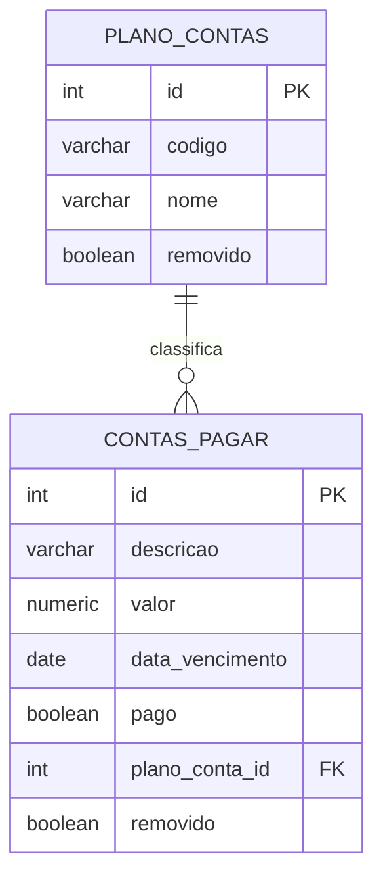

# Financeiro da Cooperativa — Contas a Pagar × Plano de Contas

Trabalho 1 de **Desenvolvimento Web III** (IFSP Votuporanga · Bacharelado em Sistemas de Informação).
Módulo financeiro de um ERP de cooperativas, com CRUD de duas tabelas relacionadas (**1:N**), login e rotas da API protegidas por **JWT**.

## Stack

| Camada | Pasta | Tecnologia | Porta |
|---|---|---|---|
| Front-end (site) | `dw3frontend/` | Python + Flask, templates Jinja, CSS e um pouco de JS | **8080** |
| Back-end (API REST) | `dw3backend/` | Python + Flask, PyJWT, psycopg2 | **5000** |
| Banco de dados (SGBD) | container `db` | PostgreSQL 16 | **5432** |

Tudo roda em containers Docker (3 serviços, 3 portas separadas — arquitetura cliente-servidor).
O front **nunca** acessa o banco: ele chama a API, e só a API fala com o PostgreSQL.

## Como rodar

### Pré-requisitos

- Docker instalado e em execução;
- Docker Compose disponível (`docker compose version`);
- portas `5432`, `5000` e `8080` livres.

### Primeira execução

Na raiz do projeto, crie os arquivos de configuração a partir dos exemplos:

```bash
cp dw3backend/.env.example dw3backend/.env
cp dw3frontend/frontend.env.example dw3frontend/frontend.env
```

Depois, inicie os três serviços:

```bash
docker compose up --build
```

Os serviços são iniciados nesta ordem:

1. `db`: PostgreSQL;
2. `backend`: API Flask;
3. `frontend`: site Flask.

Quando os containers estiverem em execução:

- Site: **http://localhost:8080**
- API: **http://localhost:5000**
- Saúde da API: **http://localhost:5000/api/health**

Na tela de login, use o usuário e a senha definidos em `dw3backend/.env`.
Com a configuração padrão, são `admin` e `admin123`.

### Comandos principais

Para iniciar em segundo plano:

```bash
docker compose up --build -d
```

Para conferir o estado dos serviços:

```bash
docker compose ps
```

Para acompanhar os logs:

```bash
docker compose logs -f
```

Para parar e remover os containers e a rede:

```bash
docker compose down
```

O banco usa o volume `pgdata`, portanto `docker compose down` preserva os dados.
Para apagar os dados e recriar o banco do zero:

```bash
docker compose down -v
docker compose up --build
```

> O arquivo `dw3backend/database/init.sql` é executado automaticamente apenas quando o volume do PostgreSQL está vazio. Use `down -v` somente quando realmente quiser perder os dados locais.

### Testes automatizados

Os testes do back-end são testes de integração: usam as rotas Flask e o PostgreSQL
dos containers. Com os serviços em execução, rode:

```bash
docker compose exec backend pytest -v
```

Para executar somente os testes de login e JWT:

```bash
docker compose exec backend pytest -v apps/login/tests/test_login.py
```

Os demais grupos de testes ficam em:

```text
dw3backend/apps/plano_contas/tests/test_plano_contas.py
dw3backend/apps/contas_pagar/tests/test_contas_pagar.py
```

Cada teste cria os dados necessários e realiza a limpeza ao final.

### Testar a API manualmente

As requisições podem ser feitas com `curl`, Postman ou Insomnia. Não há um arquivo
`.rest` obrigatório no projeto; as rotas estão documentadas em
[`docs/API.md`](docs/API.md).

Verifique a API:

```bash
curl http://localhost:5000/api/health
```

Faça login e guarde o JWT em uma variável:

```bash
TOKEN=$(curl -s -X POST http://localhost:5000/api/login \
  -H 'Content-Type: application/json' \
  -d '{"usuario":"admin","senha":"admin123"}' \
  | python3 -c "import sys,json; print(json.load(sys.stdin)['token'])")
```

Consulte uma rota protegida:

```bash
curl http://localhost:5000/api/plano-contas \
  -H "Authorization: Bearer $TOKEN"
```

Crie uma conta a pagar:

```bash
curl -X POST http://localhost:5000/api/contas-pagar \
  -H "Authorization: Bearer $TOKEN" \
  -H 'Content-Type: application/json' \
  -d '{"descricao":"Compra de materiais","valor":"250.00","data_vencimento":"2026-11-30","pago":false,"plano_conta_id":1}'
```

Uma rota protegida sem token deve responder `401`:

```bash
curl -i http://localhost:5000/api/contas-pagar
```

Consulte [`docs/API.md`](docs/API.md) para as rotas de CRUD, corpos JSON e códigos
de resposta.

## Estrutura do projeto

```
.
├── docker-compose.yml
├── .gitignore                       # ignora .env, frontend.env, __pycache__ ...
├── README.md
├── docs/                            # documentação (diagramas Mermaid)
│
├── dw3backend/                      # ===== API (porta 5000) =====
│   ├── app.py                       # cria o Flask, registra as rotas
│   ├── .env  /  .env.example        # banco, JWT, usuário inicial
│   ├── conftest.py                  # itens compartilhados pelos testes
│   ├── apps/                        # um módulo por assunto
│   │   ├── login/
│   │   │   ├── controller/          # login + decorator @token_obrigatorio (JWT)
│   │   │   ├── model/               # SQL da tabela usuarios
│   │   │   └── tests/
│   │   ├── plano_contas/
│   │   │   ├── controller/          # validações e regras de negócio
│   │   │   ├── model/               # SQL
│   │   │   └── tests/
│   │   └── contas_pagar/
│   │       ├── controller/
│   │       ├── model/
│   │       └── tests/
│   ├── routes/                      # URL -> controller (rotas finas)
│   └── database/
│       ├── conexao.py               # conexão e execução de SQL
│       └── init.sql                 # tabelas + dados de exemplo
│
└── dw3frontend/                     # ===== Site (porta 8080) =====
    ├── app.py                       # cria o Flask, sessão, tratamento de erros
    ├── frontend.env / .example      # URL da API e chave da sessão
    ├── apps/                        # funções que usam as APIs do back-end
    │   ├── api_client.py            # função base: envia o JWT e trata erros
    │   ├── login/                   # fazer_login + sessão (cookie)
    │   ├── plano_contas/            # 5 funções do CRUD
    │   └── contas_pagar/            # 5 funções do CRUD
    ├── routes/                      # URL -> tela
    ├── views/                       # templates HTML (Jinja)
    └── public/                      # css/ e js/ (arquivos estáticos)
```

## Modelo de dados



Mais detalhes e demais diagramas em [`docs/ARQUITETURA.md`](docs/ARQUITETURA.md). Referência das rotas em [`docs/API.md`](docs/API.md).

## Mapa de Conferência

| Exigência | Onde está |
|---|---|
| Cliente-servidor, servidores em portas separadas | Front `8080`, API `5000`, banco `5432` (`docker-compose.yml`) |
| Repositório no GitHub com `.gitignore` | `.gitignore` na raiz (ignora `.env`, `frontend.env`, `__pycache__`...) |
| Dados em um SGBD | PostgreSQL (`dw3backend/database/init.sql`) |
| 2 tabelas relacionadas (1:N) | `plano_contas` 1 ── N `contas_pagar` |
| Campos `ID` e `Removido` em todas as tabelas do CRUD | colunas `id` e `removido` nas duas |
| Ao menos um campo texto, decimal e data | texto: `descricao`/`nome` · decimal: `valor` (`NUMERIC(12,2)`) · data: `data_vencimento` |
| 5 APIs por tabela (GetAll, GetByID, Insert, Update, Delete) | `dw3backend/routes/` → `controller` → `model` |
| GetAll/GetByID só trazem `removido = false` | cláusula `WHERE removido = FALSE` nos models |
| Delete = *soft delete* | `UPDATE ... SET removido = TRUE` nos models |
| 5 funções de CRUD no front por tabela | `dw3frontend/apps/plano_contas/` e `apps/contas_pagar/` |
| Tela de login | `dw3frontend/views/login.html` |
| JWT protegendo as rotas | `@token_obrigatorio` em `dw3backend/apps/login/controller/` |
| JWT e dados do login guardados no front | cookie de sessão (`dw3frontend/apps/login/sessao.py`) |
| Front nunca acessa o SGBD | só o back-end importa `psycopg2` |
| Boa usabilidade | busca, filtro, confirmação de exclusão, mensagens claras, R$ e `dd/mm/aaaa`, layout responsivo |
