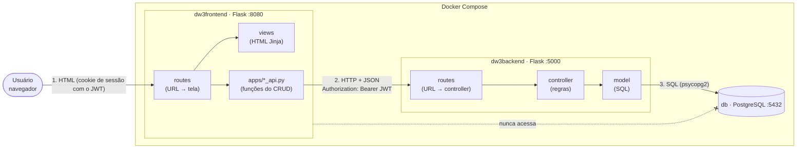
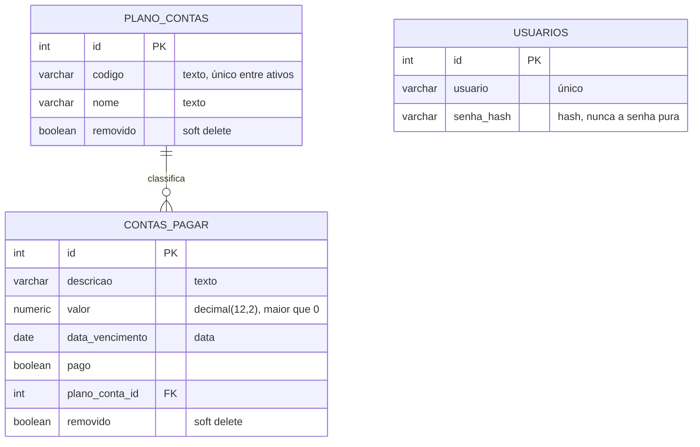
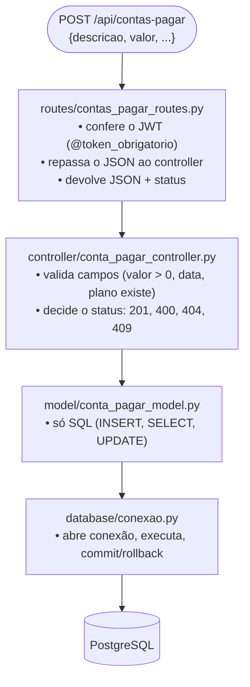
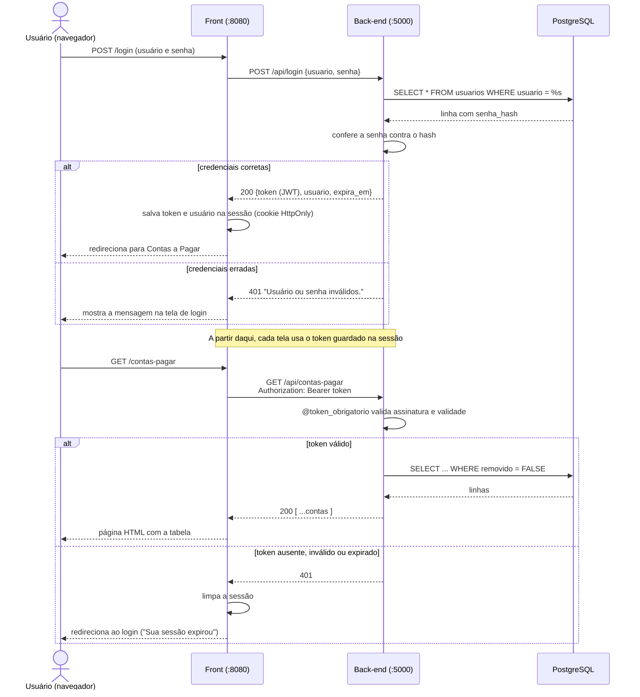

# Arquitetura

## 1. Visão geral (componentes e portas)

O navegador conversa **somente** com o site (porta 8080). O servidor do site, por baixo dos panos, chama a API (porta 5000) enviando o JWT. Somente a API conversa com o banco.

## 2. Modelo de dados (relação 1:N)

Um plano de contas (ex.: "Energia elétrica") classifica várias contas a pagar. Cada conta pertence a exatamente um plano.

`USUARIOS` é uma tabela de apoio só para o login; não faz parte do CRUD pedido e não se relaciona com as outras.

## 3. Camadas do back-end

Cada pedido atravessa as mesmas camadas, e cada camada tem uma única responsabilidade.

| Camada | Pergunta que responde | Conhece Flask? | Conhece SQL? |
|---|---|---|---|
| `routes` | "Qual URL chama o quê?" | sim | não |
| `controller` | "Os dados são válidos? Pode fazer?" | não | não |
| `model` | "Como leio/gravo no banco?" | não | sim |
| `database` | "Como me conecto?" | não | sim |

## 4. Login e uso do JWT

## 5. Soft delete (exclusão lógica)

O registro **continua na tabela**; apenas deixa de aparecer, porque `GetAll` e `GetByID` filtram `removido = FALSE`.
`DELETE /api/contas-pagar/id` segue o mesmo caminho, sem a verificação de vínculo.

## 6. Mapa: do clique na tela até o SQL

| Ação na tela | Rota do site | Função do front (`apps/`) | Rota da API | Controller → Model |
|---|---|---|---|---|
| Abrir lista de planos | `GET /plano-contas` | `get_all_plano_contas()` | `GET /api/plano-contas` | `get_all` |
| Abrir formulário de edição | `GET /plano-contas/<id>/editar` | `get_plano_conta_by_id(id)` | `GET /api/plano-contas/<id>` | `get_by_id` |
| Salvar plano novo | `POST /plano-contas/novo` | `insert_plano_conta(p)` | `POST /api/plano-contas` | `insert` |
| Salvar edição | `POST /plano-contas/<id>/editar` | `update_plano_conta(id, p)` | `PUT /api/plano-contas/<id>` | `update` |
| Confirmar exclusão | `POST /plano-contas/<id>/excluir` | `delete_plano_conta(id)` | `DELETE /api/plano-contas/<id>` | `delete` |
| Abrir lista de contas | `GET /contas-pagar` | `get_all_contas_pagar()` | `GET /api/contas-pagar` | `get_all` |
| Abrir formulário de edição | `GET /contas-pagar/<id>/editar` | `get_conta_pagar_by_id(id)` | `GET /api/contas-pagar/<id>` | `get_by_id` |
| Salvar conta nova | `POST /contas-pagar/nova` | `insert_conta_pagar(c)` | `POST /api/contas-pagar` | `insert` |
| Salvar edição | `POST /contas-pagar/<id>/editar` | `update_conta_pagar(id, c)` | `PUT /api/contas-pagar/<id>` | `update` |
| Confirmar exclusão | `POST /contas-pagar/<id>/excluir` | `delete_conta_pagar(id)` | `DELETE /api/contas-pagar/<id>` | `delete` |

> Os formulários HTML só enviam `GET` e `POST`. Por isso o **site** usa `POST` para editar e excluir; é o **servidor do site** quem chama a API com `PUT` e `DELETE`.

## 7. Decisões de projeto

| Decisão | Motivo |
|---|---|
| Estrutura `apps/<módulo>/{controller,model,tests}` + `routes` + `database` | Separa responsabilidades; cada arquivo é pequeno e fácil de explicar e testar. |
| **Flask** nos dois lados | Poucas linhas por rota; a mesma ferramenta no front e no back. |
| Front em Flask com **templates Jinja** | O HTML é montado no servidor; o JavaScript fica reduzido a um arquivo (confirmação de exclusão). |
| JWT na **sessão (cookie HttpOnly)** do front | O JavaScript da página não consegue ler o token; atende ao requisito "JWT em cookie/localStorage". |
| Sem **CORS** | O navegador só fala com `:8080`; quem chama `:5000` é o servidor do site (servidor → servidor), e CORS é uma regra só de navegadores. |
| **SQL puro** (psycopg2), sem ORM | Mostra exatamente o que roda no banco; combina com o foco em dados. |
| Parâmetros `%s` em todo SQL | Evita *SQL Injection*: o valor nunca é concatenado no texto do comando. |
| Jinja com escape automático | Texto digitado não vira HTML/script (evita *XSS*). |
| `NUMERIC(12,2)` para dinheiro | Não tem erro de arredondamento do `float`. |
| Senha com **hash** (`werkzeug.security`) | Se o banco vazar, as senhas não ficam expostas. |
| JWT `HS256` com expiração | O servidor não guarda sessão; o token carrega usuário e validade. |
| Índice único parcial em `plano_contas.codigo` | Impede código repetido entre ativos, mas libera o código de um registro removido. |
| Configurações em `.env` e `frontend.env` | Segredos fora do código e fora do Git; o `docker-compose` troca só o host (`db`, `backend`). |

## 8. Limitações conhecidas (e como evoluir)

- Os servidores do Flask (`app.run`) são para desenvolvimento/demonstração. Em produção: Gunicorn + Nginx.
- Os formulários não têm token **CSRF**. O cookie `SameSite=Lax` reduz o risco; o próximo passo seria usar Flask-WTF.
- O cookie de sessão do Flask é **assinado, mas não criptografado**: o usuário pode ler o JWT dele mesmo (e só dele). Mantê-lo `HttpOnly` impede que scripts da página o leiam.
- Todos os usuários têm o mesmo nível de acesso (não há perfis).
- Não há paginação; para milhares de registros seria necessário.
