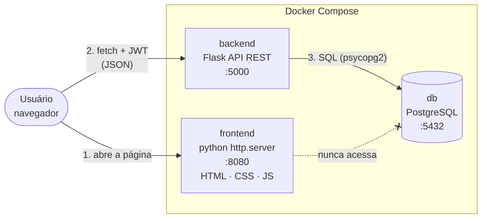
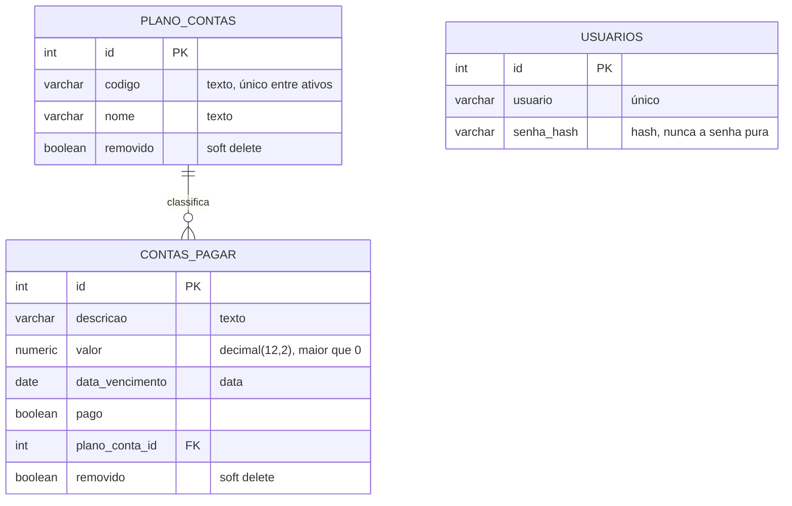
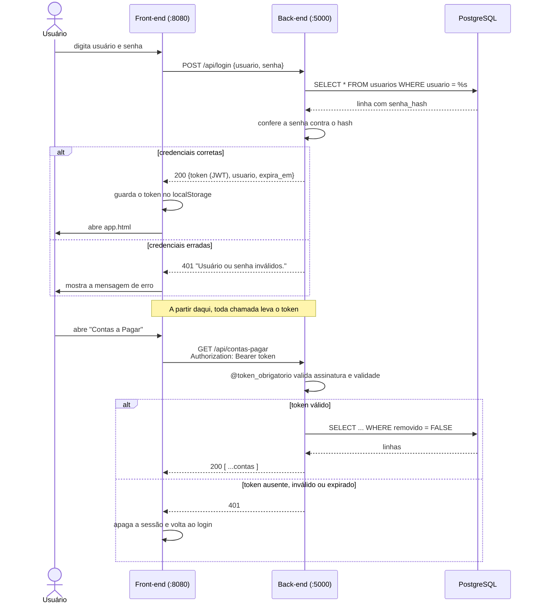
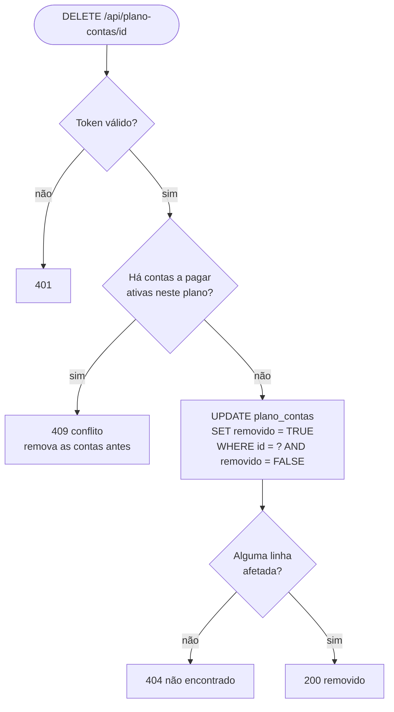

# Arquitetura

## 1. Visão geral (componentes e portas)

O navegador baixa o front-end do servidor da porta 8080 e, a partir daí, o JavaScript chama a API da porta 5000. Somente a API conversa com o banco.

## 2. Modelo de dados (relação 1:N)

Um plano de contas (ex.: "Energia elétrica") classifica várias contas a pagar. Cada conta pertence a exatamente um plano.

`USUARIOS` é uma tabela de apoio só para o login; não faz parte do CRUD pedido e não se relaciona com as outras.

## 3. Login e uso do JWT

## 4. Soft delete (exclusão lógica)

O registro **continua na tabela**; apenas deixa de aparecer, porque `GetAll` e `GetByID` filtram `removido = FALSE`.
`DELETE /api/contas-pagar/id` segue o mesmo caminho, sem a verificação de vínculo.

## 5. Mapa: função do front → rota da API → SQL

| Função do front (`api.js`) | Rota | Operação SQL |
|---|---|---|
| `getAllPlanoContas()` | `GET /api/plano-contas` | `SELECT` onde `removido = FALSE` |
| `getPlanoContaByID(id)` | `GET /api/plano-contas/<id>` | `SELECT` por id, `removido = FALSE` |
| `insertPlanoConta(p)` | `POST /api/plano-contas` | `INSERT ... RETURNING *` |
| `updatePlanoConta(id, p)` | `PUT /api/plano-contas/<id>` | `UPDATE ... RETURNING *` |
| `deletePlanoConta(id)` | `DELETE /api/plano-contas/<id>` | `UPDATE ... SET removido = TRUE` |
| `getAllContasPagar()` | `GET /api/contas-pagar` | `SELECT` onde `removido = FALSE` |
| `getContaPagarByID(id)` | `GET /api/contas-pagar/<id>` | `SELECT` por id, `removido = FALSE` |
| `insertContaPagar(c)` | `POST /api/contas-pagar` | `INSERT ... RETURNING *` |
| `updateContaPagar(id, c)` | `PUT /api/contas-pagar/<id>` | `UPDATE ... RETURNING *` |
| `deleteContaPagar(id)` | `DELETE /api/contas-pagar/<id>` | `UPDATE ... SET removido = TRUE` |

## 6. Decisões de projeto

| Decisão | Motivo |
|---|---|
| **Flask** em vez de um framework maior | Poucas linhas por rota; fácil de ler e explicar. |
| **SQL puro** (psycopg2), sem ORM | Mostra exatamente o que roda no banco; combina com o foco em dados. |
| Parâmetros `%s` em todo SQL | Evita *SQL Injection*: o valor nunca é concatenado no texto do comando. |
| `NUMERIC(12,2)` para dinheiro | Não tem erro de arredondamento do `float`. |
| Senha com **hash** (`werkzeug.security`) | Se o banco vazar, as senhas não ficam expostas. |
| JWT assinado com `HS256` e expiração | O servidor não guarda sessão; o token carrega usuário e validade. |
| **CORS** restrito a `localhost:8080` | O navegador bloqueia chamadas entre portas diferentes, a menos que a API autorize. |
| Índice único parcial em `plano_contas.codigo` | Impede código repetido entre ativos, mas libera o código de um registro removido. |
| Front sem framework | Menos "mágica"; cada função faz uma coisa visível. |

## 7. Limitações conhecidas (e como evoluir)

- O servidor do Flask (`app.run`) e o `http.server` são para desenvolvimento/demonstração. Em produção: Gunicorn + Nginx.
- O token fica no `localStorage`, que é legível por JavaScript. Mais seguro: cookie `HttpOnly`. Foi mantido assim por ser permitido no enunciado e mais simples de demonstrar.
- Todos os usuários têm o mesmo nível de acesso (não há perfis).
- Não há paginação; para milhares de registros seria necessário.
